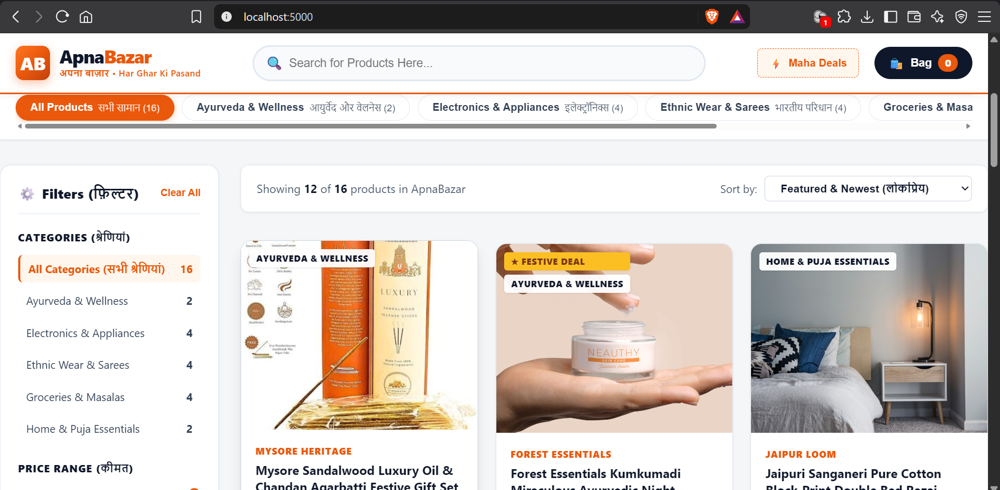
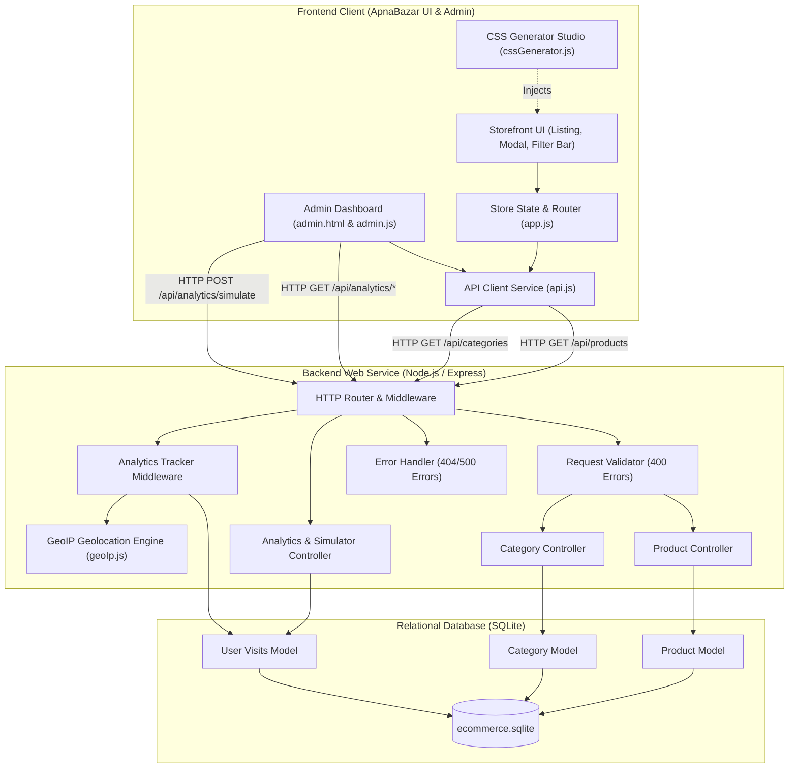
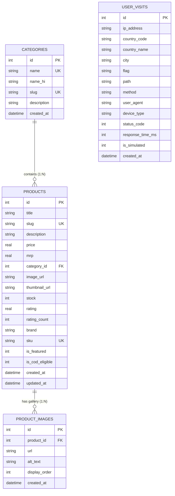

# ApnaBazar (अपना बाज़ार) — Full-Stack E-Commerce Application
### Part 1: Product Listing Website (Indian E-Commerce Platform)

ApnaBazar is production-ready full-stack e-commerce application tailored specifically for the **Indian Market**, inspired by top Indian online marketplaces such as Amazon, Flipkart, and JioMart. Built with a relational SQL database, RESTful API architecture, Indian Rupee (₹) currency handling, MRP discount computations, Cash on Delivery (COD) eligibility, and bilingual (English/Hindi) category navigation.

---

## 🌟 Key Features

### 1. Frontend Client (ApnaBazar Web Experience)
- **Indian Bazaar Theme & Branding**: Saffron and royal navy aesthetic (`#ea580c` and `#0f172a`), "अपना बाज़ार" branding, festive offer highlights, and national delivery trust badges.
- **Indian Rupee (₹) Currency & Pricing System**:
  - Live deal price in INR (e.g. `₹1,899`, `₹8,499`).
  - Original M.R.P. with strike-through and computed discount percentage tags (e.g., `M.R.P: ₹2,499` `24% OFF`).
  - "You Save: ₹600" savings calculation.
- **Indian Payment & Delivery Badges**:
  - `🚚 Free Express Delivery` over ₹499.
  - `💵 Cash on Delivery (COD)` and UPI QR accepted at doorstep.
  - Pincode delivery location selector (e.g., `Deliver to: 110001 (New Delhi)`).
- **Interactive Search & Filtering**:
  - **Live Search**: Instant search across titles, descriptions, and brands (e.g., "Kesar", "Banarasi Saree", "boAt", "Preethi").
  - **Bilingual Category Navigation**: Categories in English and Hindi with dynamic item counts:
    - Groceries & Masalas (किराना और मसाले)
    - Ethnic Wear & Sarees (भारतीय परिधान)
    - Electronics & Appliances (इलेक्ट्रॉनिक्स)
    - Home & Puja Essentials (घर और पूजा)
    - Ayurveda & Wellness (आयुर्वेद और वेलनेस)
  - **Indian Budget Price Range**: Slider from ₹500 to ₹15,000+ with one-click quick budget chips (`Under ₹1,000`, `Under ₹2,500`, `Under ₹5,000`).
  - **Availability Toggle**: "In Stock Only (तैयार स्टॉक)" checkbox.
  - **Multi-criteria Sorting**: Featured & Newest, Price (Low to High), Price (High to Low), and Highest Rated.
- **Product Details Modal & Deep Linking**:
  - Direct URL hash routing (e.g., `#/product/1` or `#/product/5`).
  - Multi-image gallery with high-res zoom and thumbnail switcher.
  - Bank offers callout (SBI, HDFC, RuPay & UPI cashbacks).
  - Specifications table (origin, manufacturer, GST inclusion, delivery ETA).
  - Quantity counter and interactive Add-to-Bag action with toast alerts.

### 2. Backend REST API
- **Modular MVC Architecture**: Clean separation between Controllers, Models, Routes, Middlewares, and Database configuration.
- **Express-Compatible Service**: Seamlessly runs on Express.js with a zero-dependency native HTTP fallback.
- **Strict Request Validation**: Validates pagination bounds, price bounds, sort enums, and integer IDs (returns `400 Bad Request` with structured error messages).
- **CORS & Latency Logging**: Enabled out of the box with standard HTTP status codes (`200`, `400`, `404`, `500`).

### 3. SQL Relational Database
- **Relational Schema**: Tables for `categories`, `products`, `product_images`, and `user_visits` with enforced foreign keys (`PRAGMA foreign_keys = ON;`).
- **Performance Indexes**: Indexes on `category_id`, `price`, `slug`, `title`, `product_id`, `country_code`, and `created_at`.
- **Sample Seed Data**: 16 iconic Indian products with MRPs, ratings, brands, and multi-image galleries.
- **Zero-Config Database**: Powered by SQLite (`ecommerce.sqlite`)—runs out-of-the-box on any machine.

### 4. Admin Dashboard: User Analytics & Web Request Simulator
- **Live User Analytics Console (`/admin.html`)**: Real-time KPI metrics showing Total Visits, Unique Visitors (distinct IPs), Global Countries Reached, Top Country Origin, and Traffic Composition (Real vs. Simulated).
- **IP-to-Country Geolocation Engine**: Built-in, high-performance offline IP-to-Country mapping covering major subnets across India, the US, UK, Germany, Canada, Australia, Japan, Singapore, UAE, France, Brazil, and 25+ countries worldwide with ISO codes, hub cities, and country flag emojis.
- **Web Request Traffic Simulator**:
  - **In-Dashboard Studio**: Trigger batch simulations (5, 15, 50 requests), click country presets (🇮🇳, 🇺🇸, 🇬🇧, 🇩🇪, 🇯🇵, etc.), inject custom IP addresses, or toggle a live streaming traffic generator with an animated real-time terminal feed.
  - **Standalone Terminal CLI**: Run `npm run simulate` or `node backend/scripts/simulateTraffic.js --count=20` or `--continuous` to simulate web traffic from terminal anytime.
- **Geographic Country Breakdown**: Visual progress bars and breakdown table of total visits and percentage share by country.
- **Live Activity Stream**: Real-time inspection table showing timestamps, client IP addresses, resolved country/city locations, visited endpoints, device platforms (Mobile, Desktop, Tablet), and response latency.

### 5. Interactive CSS Generator & Appearance Studio
- **Dynamic CSS Generator**: Easily opened via the floating "🎨 CSS Generator" button or navbar link on any page.
- **7 Pre-Built Optimized Themes**:
  - **Bharat Saffron (Default)**: Warm saffron, royal navy, and haldi gold.
  - **Modern Emerald / Eco Luxe**: Mint and forest emerald for fresh organic commerce.
  - **Midnight Cyber OLED Dark**: High-contrast OLED dark mode with glowing neon cyan accents.
  - **Royal Heritage Velvet**: Traditional royal purple and gold luxury typography.
  - **Clean Nordic Monochrome**: Ultra-clean minimalist black and white.
  - **Ocean Cobalt & Sky**: Professional corporate blue and crisp card styling.
  - **Crimson Festive Dhamaka**: Dynamic ruby red festival celebration styling.
- **Granular Customization Options**: Pick primary colors, navbar backgrounds, accents, page body background, card backgrounds, typography (Inter, Poppins, Roboto, Playfair), border radius (0px to 24px), card shadow elevation (Flat, Soft, 3D Float, Neo-Glow), and layout density (Compact, Standard, Spacious).
- **Live Preview & Persistence**: Styles update instantly on the page and automatically save to `localStorage` to persist across pages and reloads.
- **Export & Download**: One-click "Copy CSS" and "Download .css" to export pure, production-ready stylesheets.

---

## 📸 Screenshots

### 1. Product Listing Page (ApnaBazar)

Displays the ApnaBazar storefront with product categories, filters, search bar, sorting options, product cards, and Indian pricing.



---

### 2. Product Details View

Displays the product details modal with product image, ratings, SKU, pricing breakdown, discount, stock availability, bank offers, and product information.


---

## 🏛️ Application Architecture



---

## 📊 Admin Dashboard: Where to See It & What It Displays

### 📍 Where to Access the Admin Dashboard
You can open the Admin Dashboard in two ways:
1. **Direct URL**: Navigate to **[`http://localhost:5000/admin.html`](http://localhost:5000/admin.html)** (or [`http://localhost:5000/admin`](http://localhost:5000/admin)).
2. **From the Storefront**: Click the **`📊 Admin Analytics`** link in the top announcement bar or the **`📊 Admin`** button in the main navigation bar.

---

### 🔍 What You Can See on the Admin Dashboard

```
┌────────────────────────────────────────────────────────────────────────┐
│  AB ApnaBazar ADMIN   [🟢 Live IP Engine Active]   [🛍️ Storefront]     │
├────────────────────────────────────────────────────────────────────────┤
│  [ Total Visits ] [ Unique IPs ] [ Countries ] [ Top Origin ] [ Split ]│
│       1,420             89             14          🇮🇳 India     Real/Sim│
├────────────────────────────────────────────────────────────────────────┤
│  🧪 TRAFFIC SIMULATOR                                                  │
│  [Batch: 5 | 15 | 50]  [Countries: 🇮🇳 🇺🇸 🇬🇧 🇩🇪 🇯🇵 🇦🇺 ...]             │
│  [Custom IP Form: IP Address | Route | Device | 🚀 Send]               │
│  [>_ Live Terminal Console Output Stream                             ] │
├────────────────────────────────────────────────────────────────────────┤
│  🗺️ GEOGRAPHIC DISTRIBUTION (IP-to-Country Mapping)                    │
│  Flag | Country Name | ISO | Hub City | Visits | IPs | Traffic Share % │
│  🇮🇳   | India        | IN  | Jaipur   | 840    | 45  | ███████ 59%    │
│  🇺🇸   | United States| US  | Chicago  | 290    | 22  | ███     20%    │
├────────────────────────────────────────────────────────────────────────┤
│  📋 RECENT VISITOR ACTIVITY STREAM   [☑ Auto-refresh 3s] [Filter: All] │
│  Time | IP Address | Location | Target Path | Device | Type | Status   │
└────────────────────────────────────────────────────────────────────────┘
```

1. **Top KPI Metrics Grid**:
   - **Total Visits**: Real-time count of all incoming requests tracked across the platform.
   - **Unique Visitors (IPs)**: Total count of distinct public IP addresses that have connected.
   - **Countries Reached**: Count of unique countries worldwide mapped from visitor IPs.
   - **Top Country Origin**: The #1 country generating the most traffic (with flag, total visits, and % of traffic).
   - **Traffic Composition**: Breakdown of **Real Storefront Traffic** vs. **Simulated Requests**.

2. **Web Request Traffic Simulator (Interactive Testbench)**:
   - **Quick Batch Simulators**: Click `🚀 Simulate 5 Visits`, `⚡ Simulate 15 Visits`, or `💥 Simulate 50 Bulk Visits` to instantly fire realistic distributed requests.
   - **Country IP Quick Presets**: Instant simulation buttons for 11+ global countries:
     - 🇮🇳 India (Airtel / Jio subnets from Delhi, Mumbai, Bengaluru, Jaipur, Hyderabad, Pune)
     - 🇺🇸 United States (Chicago, New York, San Francisco, Dallas, Seattle)
     - 🇬🇧 United Kingdom (London, Manchester, Edinburgh)
     - 🇩🇪 Germany (Frankfurt, Berlin, Nuremberg)
     - 🇯🇵 Japan (Tokyo, Osaka)
     - 🇦🇺 Australia (Sydney, Melbourne)
     - 🇨🇦 Canada (Toronto, Vancouver)
     - 🇸🇬 Singapore, 🇦🇪 UAE, 🇫🇷 France, 🇧🇷 Brazil
   - **Custom IP Address Injection**: Enter any custom IP address (e.g. `49.36.12.85` or `142.250.190.46`), select an endpoint (`/`, `/api/products`, `/api/categories`), select a device platform (`Mobile`, `Desktop`, `Tablet`), and click **Send Simulated Request**.
   - **Live Continuous Traffic Streamer**: Click `▶ Start Live Traffic Stream` to continuously generate requests every 1.5 seconds with an animated pulsing indicator.
   - **Real-Time Terminal Console**: A hacker-style console window that displays incoming requests live, printing:
     `[Time] 🇮🇳 India (Mumbai) • IP: 49.36.12.85 • Mobile • /api/products • 200 OK (24ms)`

3. **Geographic Traffic Distribution Table (IP-to-Country Mapping)**:
   - Displays all user visits grouped by country of origin.
   - Shows: **Flag Emoji**, **Country Name**, **ISO 2-Letter Code**, **Hub City**, **Total Visit Count**, **Unique IPs**, and an animated **Traffic Share % Progress Bar**.
   - Includes a live search filter box to instantly find any country.

4. **Recent Visitor Activity Stream**:
   - A detailed real-time table displaying the latest visits.
   - Columns: **Time**, **IP Address**, **Location (Flag + Country + City)**, **Target Route**, **Device Badge** (`📱 Mobile`, `💻 Desktop`, `📟 Tablet`), **Traffic Type Badge** (`⚡ Simulated` vs. `👤 Real User`), and **HTTP Status / Response Latency**.
   - Features an **Auto-Refresh Toggle** (polls every 3.5 seconds) and a **Country Filter Dropdown**.
   - Includes a **`🗑️ Reset Logs`** button to clear analytics history and start fresh.

---

## 🎨 CSS Generator & Appearance Studio: How It Works & Options

### 📍 Where to Access the CSS Generator
You can open the CSS Generator Studio from **any page on the website**:
1. Click the floating **`🎨 CSS Generator`** pill button in the bottom-right corner of the screen.
2. Click the **`🎨 CSS Studio`** button in the main navigation bar (Storefront) or header (Admin Dashboard).

---

### 🎛️ Options to Optimize Website Appearance
The CSS Studio slides out as a sleek control panel allowing live restyling:

1. **7 Optimized Theme Presets**:
   - **Classic Bharat Saffron (Default)**: Warm Saffron (`#ea580c`), Royal Navy (`#0f172a`), Haldi Gold (`#f59e0b`).
   - **Modern Emerald / Eco Luxe**: Forest emerald (`#059669`) and mint for fresh organic wellness commerce.
   - **Midnight Cyber OLED Dark**: High-contrast OLED dark mode with glowing neon cyan accents.
   - **Royal Heritage Velvet**: Traditional royal purple (`#7c3aed`) and gold luxury editorial typography.
   - **Clean Nordic Monochrome**: Ultra-clean minimalist pitch black and pure white styling.
   - **Ocean Cobalt & Sky**: Professional corporate blue and crisp card styling.
   - **Crimson Festive Dhamaka**: Dynamic ruby red festival celebration theme.

2. **Granular Color Customization**:
   - **Primary Brand Color**: Pick any hex color for main buttons, badges, highlights, and active tabs.
   - **Navbar & Topbar Color**: Customize the top announcement bar and main navigation header.
   - **Accent & Deals Color**: Adjust the Maha Deals badge, offer pills, and star rating colors.
   - **Page Background Color**: Switch between crisp white, light gray, warm cream, or dark mode backgrounds.
   - **Card Background Color**: Fine-tune the background fill of product listing cards.

3. **Geometry, Typography & Elevation Optimization**:
   - **Corner Radius Slider (0px to 24px)**: Choose between sharp modern edges (0px), standard rounded corners (8–10px), or pill-shaped curves (24px).
   - **Typography Selection**: Choose between *System Sans*, *Inter (Clean Modern)*, *Poppins (Friendly)*, *Roboto (Material)*, or *Playfair Display (Luxury Serif)*.
   - **Card Shadow Profiles**:
     - `Flat`: Zero shadow for maximum rendering speed and minimalist aesthetics.
     - `Subtle Modern Soft`: Balanced, clean SaaS-style shadow.
     - `Elevated Float 3D`: Deep layered shadow for high-contrast product emphasis.
     - `Neo-Glow`: Accent-colored glowing aura around cards.
   - **Catalogue Grid Density**:
     - `Standard`: 4 columns (balanced desktop default).
     - `Compact Density`: 5 columns (high-volume catalog view).
     - `Spacious Showcase`: 3 columns (large editorial cards).

4. **Live Real-Time Application (Zero Page Reload)**:
   - Adjusting any slider or color immediately updates the website visually in real time using dynamic `<style id="dynamic-custom-css">` injection in `<head>`.

5. **Live Pure CSS Code Viewer**:
   - Displays the fully formatted, syntax-styled pure CSS stylesheet generated from your selections with real-time byte count.

6. **Export & Persistence Actions**:
   - **`💾 Apply & Save Theme`**: Persists the custom theme to `localStorage`. The custom styling will stay active across page navigations and browser restarts.
   - **`📋 Copy CSS`**: Copies the pure CSS code to your clipboard with one click.
   - **`⬇ Download .css`**: Generates and downloads a standalone `apnabazar-custom-theme.css` file ready for production deployment.
   - **`🔄 Reset to Default Website CSS`**: Clears custom overrides and immediately restores the default ApnaBazar look.

---

---

## 🗄️ Database Schema (ERD)



---

## 🔌 API Endpoints Reference

Base URL: `http://localhost:5000`

| Method | Endpoint | Description | Status Codes |
| :--- | :--- | :--- | :--- |
| `GET` | `/api/health` | Health & service status check | `200` |
| `GET` | `/api/categories` | Retrieve all categories with product counts | `200`, `500` |
| `GET` | `/api/categories/:id` | Retrieve single category details | `200`, `400`, `404` |
| `GET` | `/api/products` | Retrieve catalog with search, filter, and pagination | `200`, `400`, `500` |
| `GET` | `/api/products/:id` | Retrieve single product with multi-image gallery | `200`, `400`, `404` |
| `GET` | `/api/products/slug/:slug` | Retrieve single product by slug identifier | `200`, `404` |
| `GET` | `/api/analytics/summary` | Retrieve KPI metrics (total visits, unique IPs, countries) | `200`, `500` |
| `GET` | `/api/analytics/countries` | Retrieve country breakdown with visit counts & percentages | `200`, `500` |
| `GET` | `/api/analytics/recent` | Retrieve recent visitor logs with IP & location | `200`, `500` |
| `GET` | `/api/analytics/presets` | Retrieve list of simulator country IP presets | `200` |
| `POST` | `/api/analytics/simulate` | Simulate web requests from various global IP addresses | `201`, `500` |
| `POST` | `/api/analytics/clear` | Clear all analytics visitor history | `200`, `500` |

### Sample API Response (`GET /api/products/1`)
```json
{
  "success": true,
  "data": {
    "id": 1,
    "title": "Kashmiri Shahi Mogra Saffron (Kesar) & Dry Fruit Hamper",
    "slug": "kashmiri-shahi-mogra-saffron-and-dry-fruit-hamper",
    "description": "Grade-A1 pure Pamposh valley red gold saffron (5g) accompanied by roasted Californian almonds and jumbo cashews in an artisanal brass-embossed gift box...",
    "price": 1899.00,
    "mrp": 2499.00,
    "category_name": "Groceries & Masalas",
    "category_name_hi": "किराना और मसाले",
    "stock": 40,
    "rating": 4.9,
    "rating_count": 342,
    "brand": "Kashmir Crown",
    "sku": "AB-GROC-001",
    "is_cod_eligible": 1,
    "images": [
      {
        "id": 1,
        "url": "https://images.unsplash.com/photo-1599940824399-b87987ceb72a?auto=format&fit=crop&w=1000&q=80",
        "alt_text": "Kashmiri Kesar and Almonds Hamper",
        "display_order": 1
      }
    ]
  }
}
```

---

## 🚀 Running on a Single Computer

### 1. Prerequisites
- **Node.js**: `v18.0.0` or higher (`v22+` / `v24+` recommended).
- **Git**

### 2. Quick Setup & Start
```bash
# 1. Initialize & seed the SQLite database with Indian catalogue
npm run db:init
# (or directly: node backend/database/initDb.js)

# 2. Start the full application (Backend API + Frontend Web + Admin)
npm start
# (or directly: node server.js)
```

The application will start at **`http://localhost:5000`**:
- **Storefront**: `http://localhost:5000/`
- **Admin Dashboard**: `http://localhost:5000/admin.html`
- **API Health**: `http://localhost:5000/api/health`

### 3. Simulate Global Web Traffic (CLI or Browser)
You can simulate web traffic either directly inside the Admin Dashboard web UI or via the CLI:
```bash
# Simulate 15 requests from global IP addresses
npm run simulate

# Simulate 25 requests specifically from India
node backend/scripts/simulateTraffic.js --count=25 --country=IN

# Simulate a specific IP address
node backend/scripts/simulateTraffic.js --ip=142.250.190.46

# Continuously stream requests in background (every 1 second)
node backend/scripts/simulateTraffic.js --continuous --delay=1000
```

### 4. Run Automated Tests
```bash
npm test
```
*(All 46 automated tests pass, verifying GeoIP mappings, simulator endpoints, analytics tracking, categories, price bounds, slug resolution, and 400/404 error responses).*

---

## 📁 Repository Structure

```
ProgLabProject/
├── backend/
│   ├── database/
│   │   ├── schema.sql            # Relational DDL (categories, products, product_images, user_visits)
│   │   ├── seed.sql              # Indian catalogue (16 products, 5 categories, 20 images)
│   │   ├── initDb.js             # Standalone migration & init script
│   │   └── ecommerce.sqlite      # SQLite database file
│   ├── scripts/
│   │   └── simulateTraffic.js    # CLI global web request traffic simulator
│   ├── src/
│   │   ├── config/db.js          # SQLite connection, WAL mode & auto-table init
│   │   ├── controllers/          # Product, category, and analytics controllers
│   │   ├── models/               # Relational SQL models with parameterized queries
│   │   ├── routes/               # Product, category, and analytics API routes
│   │   ├── middlewares/          # Validation, error handling, and analyticsTracker
│   │   ├── utils/
│   │   │   ├── geoIp.js          # IP-to-Country geolocation engine & presets
│   │   │   └── router.js         # Zero-dependency router, body parser & static server
│   │   └── app.js                # App configuration, analytics tracker & routes
│   ├── tests/
│   │   ├── api.test.js           # Catalogue & validation tests (27 test cases)
│   │   └── analytics.test.js     # GeoIP, simulator & analytics tests (19 test cases)
│   ├── package.json
│   └── server.js
├── frontend/
│   ├── css/
│   │   ├── styles.css            # Indian aesthetic (Saffron, Navy, Haldi Gold, Green)
│   │   ├── admin.css             # Admin dashboard, KPIs, tables & live terminal styling
│   │   └── css-generator.css     # CSS Studio drawer, color pickers & theme presets
│   ├── js/
│   │   ├── api.js                # Storefront REST API service client
│   │   ├── app.js                # State controller, INR formatting, filters & modal
│   │   ├── admin.js              # Admin analytics controller, live stream & charts
│   │   └── cssGenerator.js       # Live CSS generator engine, theme presets & exporter
│   ├── index.html                # ApnaBazar single-page application storefront
│   └── admin.html                # Admin Analytics & Web Request Simulator Dashboard
├── screenshots/
│   ├── product-listing-page.png  # PNG raster version
│   └── product-detail-page.png   # PNG raster version
├── .gitignore
├── package.json                  # Root monorepo launcher
├── server.js                     # Unified server entry point
└── README.md                     # Documentation & setup guide
```

---

## 📄 License
MIT License. Developed for Full-Stack E-Commerce Engineering Part 1.
