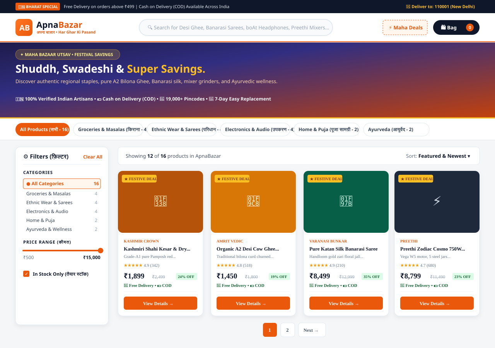
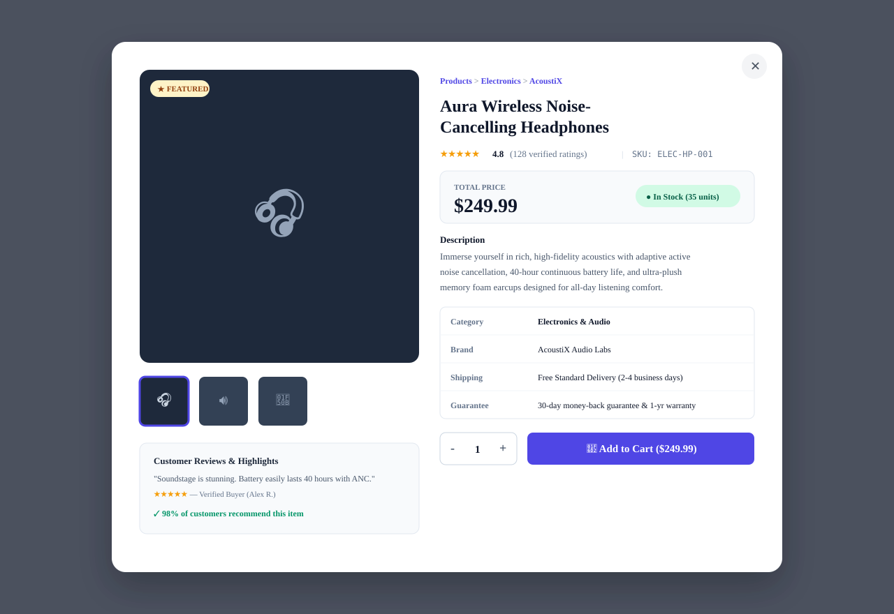
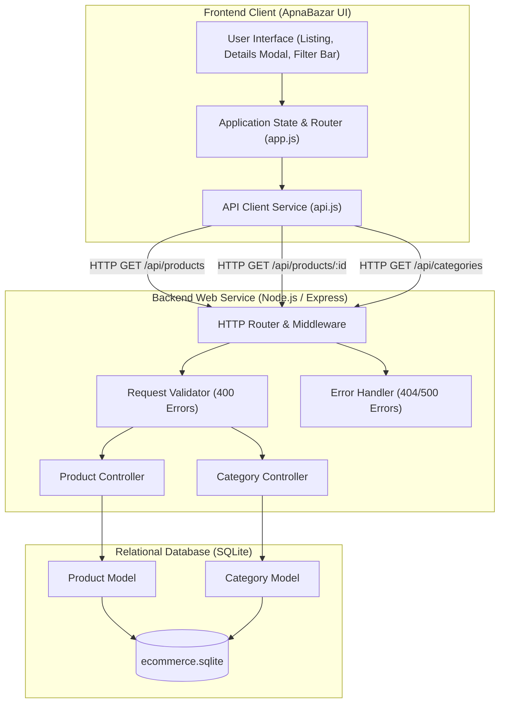
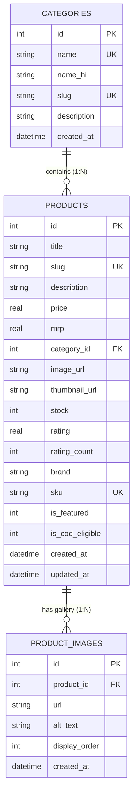

# ApnaBazar (अपना बाज़ार) — Full-Stack E-Commerce Application
### Part 1: Product Listing Website (Indian E-Commerce Platform)

ApnaBazar is production-ready full-stack e-commerce application tailored specifically for the **Indian Market**, inspired by top Indian online marketplaces such as Amazon, Flipkart, and JioMart. Built with a relational SQL database, RESTful API architecture, Indian Rupee (₹) currency handling, MRP discount computations, Cash on Delivery (COD) eligibility, and bilingual (English/Hindi) category navigation.

---

## 🌟 Key Features

### 1. Frontend Client (ApnaBazar Web Experience)
- **Indian Bazaar Theme & Branding**: Saffron and royal navy aesthetic (`#ea580c` and `#0f172a`), "अपना बाज़ार" branding, festive offer highlights, and national delivery trust badges.
- **Indian Rupee (₹) Currency & Pricing System**:
  - Live deal price in INR (e.g. `₹1,899`, `₹8,499`).
  - Original M.R.P. with strike-through and computed discount percentage tags (e.g., `M.R.P: ₹2,499` `24% OFF`).
  - "You Save: ₹600" savings calculation.
- **Indian Payment & Delivery Badges**:
  - `🚚 Free Express Delivery` over ₹499.
  - `💵 Cash on Delivery (COD)` and UPI QR accepted at doorstep.
  - Pincode delivery location selector (e.g., `Deliver to: 110001 (New Delhi)`).
- **Interactive Search & Filtering**:
  - **Live Search**: Instant search across titles, descriptions, and brands (e.g., "Kesar", "Banarasi Saree", "boAt", "Preethi").
  - **Bilingual Category Navigation**: Categories in English and Hindi with dynamic item counts:
    - Groceries & Masalas (किराना और मसाले)
    - Ethnic Wear & Sarees (भारतीय परिधान)
    - Electronics & Appliances (इलेक्ट्रॉनिक्स)
    - Home & Puja Essentials (घर और पूजा)
    - Ayurveda & Wellness (आयुर्वेद और वेलनेस)
  - **Indian Budget Price Range**: Slider from ₹500 to ₹15,000+ with one-click quick budget chips (`Under ₹1,000`, `Under ₹2,500`, `Under ₹5,000`).
  - **Availability Toggle**: "In Stock Only (तैयार स्टॉक)" checkbox.
  - **Multi-criteria Sorting**: Featured & Newest, Price (Low to High), Price (High to Low), and Highest Rated.
- **Product Details Modal & Deep Linking**:
  - Direct URL hash routing (e.g., `#/product/1` or `#/product/5`).
  - Multi-image gallery with high-res zoom and thumbnail switcher.
  - Bank offers callout (SBI, HDFC, RuPay & UPI cashbacks).
  - Specifications table (origin, manufacturer, GST inclusion, delivery ETA).
  - Quantity counter and interactive Add-to-Bag action with toast alerts.

### 2. Backend REST API
- **Modular MVC Architecture**: Clean separation between Controllers, Models, Routes, Middlewares, and Database configuration.
- **Express-Compatible Service**: Seamlessly runs on Express.js with a zero-dependency native HTTP fallback.
- **Strict Request Validation**: Validates pagination bounds, price bounds, sort enums, and integer IDs (returns `400 Bad Request` with structured error messages).
- **CORS & Latency Logging**: Enabled out of the box with standard HTTP status codes (`200`, `400`, `404`, `500`).

### 3. SQL Relational Database
- **Relational Schema**: Tables for `categories`, `products`, and `product_images` with enforced foreign keys (`PRAGMA foreign_keys = ON;`).
- **Performance Indexes**: Indexes on `category_id`, `price`, `slug`, `title`, and `product_id`.
- **Sample Seed Data**: 16 iconic Indian products with MRPs, ratings, brands, and multi-image galleries.
- **Zero-Config Database**: Powered by SQLite (`ecommerce.sqlite`)—runs out-of-the-box on any machine.

---

## 📸 Screenshots

### 1. Product Listing Page (ApnaBazar)
*Displays the top Indian announcement bar, ApnaBazar branding, festive banner, category quick chips, filter sidebar, and product cards grid with INR pricing, MRPs, and discount tags.*



*(Raster PNG fallback available at `screenshots/product-listing-page.png`)*

---

### 2. Product Details View (Modal / Deep Link)
*Displays the multi-image gallery, breadcrumbs, rating, MRP savings breakdown, Indian bank offers, delivery to pincode, specifications table, and Add-to-Bag action.*



*(Raster PNG fallback available at `screenshots/product-detail-page.png`)*

---

## 🏛️ Application Architecture



---

## 🗄️ Database Schema (ERD)



---

## 🔌 API Endpoints Reference

Base URL: `http://localhost:5000`

| Method | Endpoint | Description | Status Codes |
| :--- | :--- | :--- | :--- |
| `GET` | `/api/health` | Health & service status check | `200` |
| `GET` | `/api/categories` | Retrieve all categories with product counts | `200`, `500` |
| `GET` | `/api/categories/:id` | Retrieve single category details | `200`, `400`, `404` |
| `GET` | `/api/products` | Retrieve catalog with search, filter, and pagination | `200`, `400`, `500` |
| `GET` | `/api/products/:id` | Retrieve single product with multi-image gallery | `200`, `400`, `404` |
| `GET` | `/api/products/slug/:slug` | Retrieve single product by slug identifier | `200`, `404` |

### Sample API Response (`GET /api/products/1`)
```json
{
  "success": true,
  "data": {
    "id": 1,
    "title": "Kashmiri Shahi Mogra Saffron (Kesar) & Dry Fruit Hamper",
    "slug": "kashmiri-shahi-mogra-saffron-and-dry-fruit-hamper",
    "description": "Grade-A1 pure Pamposh valley red gold saffron (5g) accompanied by roasted Californian almonds and jumbo cashews in an artisanal brass-embossed gift box...",
    "price": 1899.00,
    "mrp": 2499.00,
    "category_name": "Groceries & Masalas",
    "category_name_hi": "किराना और मसाले",
    "stock": 40,
    "rating": 4.9,
    "rating_count": 342,
    "brand": "Kashmir Crown",
    "sku": "AB-GROC-001",
    "is_cod_eligible": 1,
    "images": [
      {
        "id": 1,
        "url": "https://images.unsplash.com/photo-1599940824399-b87987ceb72a?auto=format&fit=crop&w=1000&q=80",
        "alt_text": "Kashmiri Kesar and Almonds Hamper",
        "display_order": 1
      }
    ]
  }
}
```

---

## 🚀 Running on a Single Computer

### 1. Prerequisites
- **Node.js**: `v18.0.0` or higher (`v22+` / `v24+` recommended).
- **Git**

### 2. Quick Setup & Start
```bash
# 1. Initialize & seed the SQLite database with Indian catalogue
npm run db:init
# (or directly: node backend/database/initDb.js)

# 2. Start the full application (Backend API + Frontend Web)
npm start
# (or directly: node server.js)
```

The application will start at **`http://localhost:5000`**.

### 3. Run Automated Tests
```bash
npm test
# (or directly: node --test backend/tests/api.test.js)
```
*(All 25 automated tests pass, verifying Indian product queries, categories, price bounds, slug resolution, and 400/404 error responses).*

---

## 📁 Repository Structure

```
ProgLabProject/
├── backend/
│   ├── database/
│   │   ├── schema.sql            # Relational DDL (categories, products, product_images)
│   │   ├── seed.sql              # Indian catalogue (16 products, 5 categories, 20 images)
│   │   ├── initDb.js             # Standalone migration & init script
│   │   └── ecommerce.sqlite      # SQLite database file
│   ├── src/
│   │   ├── config/db.js          # SQLite connection & foreign key setup
│   │   ├── controllers/          # Product and category controllers
│   │   ├── models/               # Relational SQL models with parameterized queries
│   │   ├── routes/               # Express-compatible API routes
│   │   ├── middlewares/          # Validation and error handling
│   │   ├── utils/router.js       # Zero-dependency router & static asset server
│   │   └── app.js                # App configuration & middleware chain
│   ├── tests/api.test.js         # Automated test suite (25 test cases)
│   ├── package.json
│   └── server.js
├── frontend/
│   ├── css/styles.css            # Indian aesthetic (Saffron, Navy, Haldi Gold, Green)
│   ├── js/api.js                 # REST API service client
│   ├── js/app.js                 # State controller, INR formatting, filters & modal
│   └── index.html                # ApnaBazar single-page application markup
├── screenshots/
│   ├── product-listing-page.svg  # ApnaBazar listing page screenshot
│   ├── product-listing-page.png  # PNG raster version
│   ├── product-detail-page.svg   # ApnaBazar product detail modal screenshot
│   └── product-detail-page.png   # PNG raster version
├── .gitignore
├── package.json                  # Root monorepo launcher
├── server.js                     # Unified server entry point
└── README.md                     # Documentation & setup guide
```

---

## 📄 License
MIT License. Developed for Full-Stack E-Commerce Engineering Part 1.
