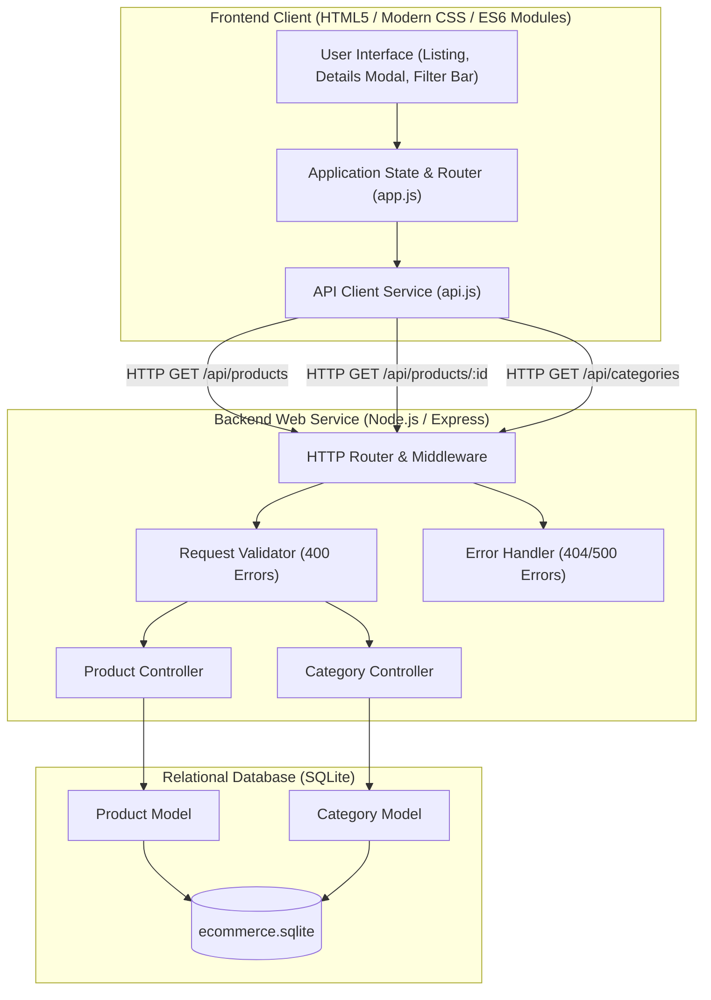
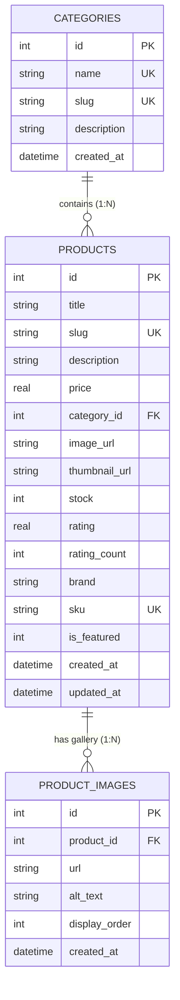

# Aurora Market — Full-Stack E-Commerce Application
### Part 1: Product Listing Website

A production-grade, responsive e-commerce web application backed by a relational SQL database. This project represents **Part 1** of a three-stage full-stack engineering curriculum, establishing the core architecture for product browsing, catalog searching, dynamic filtering, relational data modeling, and RESTful API design.

---

## 🌟 Key Features

### 1. Frontend Client
- **Dynamic Product Catalogue**: Responsive grid layout adapting seamlessly across mobile, tablet, and desktop screens.
- **Product Presentation**: High-resolution photography, formatted pricing, star ratings, review counts, brand tags, and stock inventory badges.
- **Interactive Search & Filtering**:
  - **Live Search**: Instant text search across product titles, descriptions, and brands with debounce.
  - **Category Navigation**: Filter by category (Electronics, Footwear, Fashion, Home & Kitchen, Accessories) with live item count badges.
  - **Price Range Control**: Dual filter with interactive slider and minimum/maximum numeric price inputs.
  - **Availability Toggle**: One-click "In Stock Only" switch.
  - **Multi-criteria Sorting**: Sort by Featured/Newest, Price (Low to High), Price (High to Low), Highest Rated, or Name (A to Z).
  - **Active Filter Pills**: Removable badges for all active query parameters with a global "Clear All" button.
- **Product Details Modal & Deep Linking**:
  - Detailed product view accessible via product card click or direct URL hash (e.g. `#/product/1`).
  - Interactive multi-image gallery with clickable thumbnail strip.
  - Complete product specifications, SKU code, category breadcrumbs, and availability pills.
  - Quantity counter and interactive Add-to-Cart action preview with toast notifications.
- **State Management & UX**: Loading skeletons, graceful empty-state fallbacks, toast alerts, and smooth CSS transitions.

### 2. Backend REST API
- **Modular MVC Architecture**: Clean separation between Controllers, Models, Routes, Middlewares, and Database configuration.
- **Express-Compatible Web Service**: Built to run seamlessly on Express.js with a built-in zero-dependency HTTP fallback engine.
- **Strict Request Validation**: Validates pagination bounds, price ranges, sort enums, and numerical resource IDs.
- **Standard HTTP Status Codes**: Explicit `200 OK`, `400 Bad Request`, `404 Not Found`, and `500 Internal Server Error` responses with descriptive JSON error envelopes.
- **CORS & Logging**: Cross-Origin Resource Sharing enabled out of the box with request latency logging.

### 3. SQL Relational Database
- **Relational Schema**: Normalized tables (`categories`, `products`, `product_images`) with enforced foreign key constraints (`ON DELETE RESTRICT` / `ON DELETE CASCADE`).
- **Performance Indexes**: B-Tree indexes on `category_id`, `price`, `slug`, `title`, and `product_id`.
- **Sample Seed Data**: Pre-loaded with 16 realistic e-commerce products, 5 categories, and 21 gallery images.
- **Zero-Config Database**: Powered by SQLite via Node.js standard database synchronization—no external database servers or Docker required.

---

## 📸 Screenshots

### 1. Product Listing Page
*Shows the responsive navbar, search input, autumn promotional hero banner, category quick chips, filter sidebar, and product cards grid.*


*(Raster PNG fallback available at `screenshots/product-listing-page.png`)*

---

### 2. Product Details View (Modal / Deep Link)
*Shows the detailed view with breadcrumbs, multi-image gallery switcher, ratings, stock status pill, complete specifications table, and Add-to-Cart controls.*


*(Raster PNG fallback available at `screenshots/product-detail-page.png`)*

---

## 🏛️ Application Architecture



---

## 🗄️ Relational Database Schema (ERD)



---

## 🔌 API Endpoints Reference

Base URL: `http://localhost:5000`

| Method | Endpoint | Description | Status Codes |
| :--- | :--- | :--- | :--- |
| `GET` | `/api/health` | Service uptime and health check | `200` |
| `GET` | `/api/categories` | Retrieve all categories with product counts | `200`, `500` |
| `GET` | `/api/categories/:id` | Retrieve single category details | `200`, `400`, `404` |
| `GET` | `/api/products` | Retrieve catalog with search, filter, and pagination | `200`, `400`, `500` |
| `GET` | `/api/products/:id` | Retrieve single product with multi-image gallery | `200`, `400`, `404` |
| `GET` | `/api/products/slug/:slug` | Retrieve single product by slug identifier | `200`, `404` |

### Query Parameters for `GET /api/products`

| Parameter | Type | Default | Description | Example |
| :--- | :--- | :--- | :--- | :--- |
| `search` | String | `""` | Search in title, description, and brand | `?search=wireless` |
| `category` | String | `""` | Filter by category slug or ID | `?category=electronics` |
| `minPrice` | Number | `0` | Minimum product price | `?minPrice=50` |
| `maxPrice` | Number | `∞` | Maximum product price | `?maxPrice=250` |
| `inStock` | Boolean | `false`| Only return items with `stock > 0` | `?inStock=true` |
| `sort` | String | `newest`| `newest`, `price_asc`, `price_desc`, `rating_desc`, `title_asc` | `?sort=price_asc` |
| `page` | Integer| `1` | Page number (1-indexed) | `?page=1` |
| `limit` | Integer| `12` | Items per page (1 to 100) | `?limit=8` |

### Sample API Request & Response

#### 1. Retrieve Product Catalogue
**Request:**
```bash
curl -X GET "http://localhost:5000/api/products?category=electronics&limit=2"
```

**Response (`200 OK`):**
```json
{
  "success": true,
  "count": 2,
  "pagination": {
    "total": 4,
    "page": 1,
    "limit": 2,
    "totalPages": 2,
    "hasPrevPage": false,
    "hasNextPage": true
  },
  "data": [
    {
      "id": 1,
      "title": "Aura Wireless Noise-Cancelling Headphones",
      "slug": "aura-wireless-noise-cancelling-headphones",
      "description": "Immerse yourself in rich, high-fidelity acoustics with adaptive active noise cancellation, 40-hour battery life, and ultra-plush memory foam earcups.",
      "price": 249.99,
      "category_id": 1,
      "category_name": "Electronics",
      "category_slug": "electronics",
      "image_url": "https://images.unsplash.com/photo-1505740420928-5e560c06d30e?auto=format&fit=crop&w=800&q=80",
      "stock": 35,
      "rating": 4.8,
      "rating_count": 128,
      "brand": "AcoustiX",
      "sku": "ELEC-HP-001",
      "is_featured": 1
    }
  ]
}
```

#### 2. Retrieve Product Details with Gallery
**Request:**
```bash
curl -X GET "http://localhost:5000/api/products/1"
```

**Response (`200 OK`):**
```json
{
  "success": true,
  "data": {
    "id": 1,
    "title": "Aura Wireless Noise-Cancelling Headphones",
    "slug": "aura-wireless-noise-cancelling-headphones",
    "description": "Immerse yourself in rich, high-fidelity acoustics with adaptive active noise cancellation...",
    "price": 249.99,
    "category_name": "Electronics",
    "stock": 35,
    "rating": 4.8,
    "brand": "AcoustiX",
    "sku": "ELEC-HP-001",
    "images": [
      {
        "id": 1,
        "url": "https://images.unsplash.com/photo-1505740420928-5e560c06d30e?auto=format&fit=crop&w=1000&q=80",
        "alt_text": "Aura Headphones front view",
        "display_order": 1
      },
      {
        "id": 2,
        "url": "https://images.unsplash.com/photo-1484704849700-f032a568e944?auto=format&fit=crop&w=1000&q=80",
        "alt_text": "Aura Headphones angled side view",
        "display_order": 2
      }
    ]
  }
}
```

#### 3. Error Handling Example (Validation Failure)
**Request:**
```bash
curl -X GET "http://localhost:5000/api/products?minPrice=300&maxPrice=100"
```

**Response (`400 Bad Request`):**
```json
{
  "success": false,
  "error": "Validation Error",
  "details": [
    "Query parameter \"minPrice\" cannot be greater than \"maxPrice\"."
  ]
}
```

---

## 📁 Repository Structure

```
ProgLabProject/
├── backend/
│   ├── database/
│   │   ├── schema.sql            # Relational DDL (tables, foreign keys, indexes)
│   │   ├── seed.sql              # Sample data (16 products, 5 categories, 21 images)
│   │   ├── initDb.js             # Standalone database initialization script
│   │   └── ecommerce.sqlite      # SQLite database file (auto-generated)
│   ├── src/
│   │   ├── config/
│   │   │   └── db.js             # SQLite database connection & foreign key setup
│   │   ├── controllers/
│   │   │   ├── productController.js  # Product query & detail handlers
│   │   │   └── categoryController.js # Category list & detail handlers
│   │   ├── models/
│   │   │   ├── Product.js        # Parameterized SQL queries for products
│   │   │   └── Category.js       # SQL queries for categories
│   │   ├── routes/
│   │   │   ├── productRoutes.js  # Product API route mappings
│   │   │   └── categoryRoutes.js # Category API route mappings
│   │   ├── middlewares/
│   │   │   ├── requestValidator.js   # Input validation (params, bounds)
│   │   │   └── errorHandler.js       # Centralized 404 & 500 error handlers
│   │   ├── utils/
│   │   │   └── router.js         # Zero-dependency Express-compatible router & static server
│   │   └── app.js                # Server setup, middleware, and route mounting
│   ├── tests/
│   │   └── api.test.js           # Automated test suite (25 test cases)
│   ├── package.json              # Backend package configuration
│   └── server.js                 # Backend server entry point
├── frontend/
│   ├── css/
│   │   └── styles.css            # Custom responsive CSS design system
│   ├── js/
│   │   ├── api.js                # Frontend REST API client
│   │   └── app.js                # State management, filtering, and DOM controller
│   └── index.html                # Main single-page application markup
├── screenshots/
│   ├── product-listing-page.svg  # High-resolution vector screenshot (Listing view)
│   ├── product-listing-page.png  # PNG raster screenshot
│   ├── product-detail-page.svg   # High-resolution vector screenshot (Details view)
│   └── product-detail-page.png   # PNG raster screenshot
├── scripts/
│   └── generate_screenshots.py  # Automation script to generate screenshots
├── .gitignore                    # Git ignore configuration
├── package.json                  # Root monorepo package configuration
├── server.js                     # Root launcher (runs backend + frontend on single port)
└── README.md                     # Comprehensive documentation & setup instructions
```

---

## 🚀 Prerequisites & Local Setup

### Prerequisites
- **Node.js**: `v18.0.0` or higher (`v22+` / `v24+` recommended for built-in SQLite).
- **Operating System**: Windows, macOS, or Linux.
- **Git**: Installed on your system.

*No external database server (PostgreSQL/MySQL) or container runtime (Docker) is required! Everything is self-contained.*

---

### Step-by-Step Instructions

#### 1. Clone the Repository
```bash
git clone <repository-url>
cd ProgLabProject
```

#### 2. (Optional) Install Dependencies
The application is engineered with a **zero-dependency fallback**, meaning it can run immediately using Node.js core libraries. If you wish to install the standard Express and CORS packages:
```bash
npm install
```

#### 3. Initialize / Seed the Database
The database auto-initializes on first launch. If you wish to explicitly run or reset the schema and seed scripts:
```bash
npm run db:init
# Or directly:
node backend/database/initDb.js
```

**Expected Output:**
```
[DB INIT] Initializing SQLite database at: .../ecommerce.sqlite
[DB INIT] Executing schema.sql...
[DB INIT] Executing seed.sql...
[DB INIT] Successfully initialized database!
  - Categories: 5
  - Products:   16
  - Images:     21
```

#### 4. Start the Application
Start both the backend REST API and the frontend web server with a single command:
```bash
npm start
# Or directly:
node server.js
```

**Expected Output:**
```
====================================================
   FULL-STACK E-COMMERCE APPLICATION (PART 1)       
====================================================
 Framework: Native HTTP (Zero-Dependency) / Express.js
 Database:  SQLite (Relational SQL)
 Server:    http://localhost:5000
 Web App:   http://localhost:5000/
 API Base:  http://localhost:5000/api/products
 Health:    http://localhost:5000/api/health
====================================================
```

#### 5. Open in Your Browser
Visit [http://localhost:5000](http://localhost:5000) in your web browser to browse the e-commerce website.

---

## 🧪 Running Automated Tests

A comprehensive test suite is included in `backend/tests/api.test.js`, testing all health, category, catalogue, detail, search, filter, and error-handling requirements:

```bash
npm test
# Or directly:
node --test backend/tests/api.test.js
```

**Test Coverage Summary:**
- ✔ **Health Check**: Validates `GET /api/health` status and uptime.
- ✔ **Category Endpoints**: Validates list counts, single category lookup, and 404 behavior.
- ✔ **Catalogue Browsing**: Validates pagination, field structure, and default limits.
- ✔ **Search & Filtering**: Validates title/description substring search, category slug filtering, and price range bounds.
- ✔ **Sorting**: Validates ascending and descending price order.
- ✔ **Product Details**: Validates multi-image gallery extraction and non-existent IDs.
- ✔ **Input Validation**: Validates rejection of non-numeric IDs, negative IDs, inverted price ranges, and invalid sort parameters (HTTP 400).

---

## 🛣️ Evolution Roadmap

This project is structured for smooth evolutionary development in upcoming stages:

- **Part 2 — Cart & Authentication**:
  - Persistent shopping cart sessions (server-side & client-side).
  - User registration, password hashing (bcrypt), and JWT-based authentication.
  - Role-based authorization (customer vs. store administrator).
- **Part 3 — Migrations, Logging & Monitoring**:
  - Automated database migration runner (versioned migration scripts).
  - Structured request and error logging with Winston/Morgan.
  - Prometheus metrics exporter, health probes, and application performance monitoring.

---

## 📄 License
This project is open-source under the MIT License.
